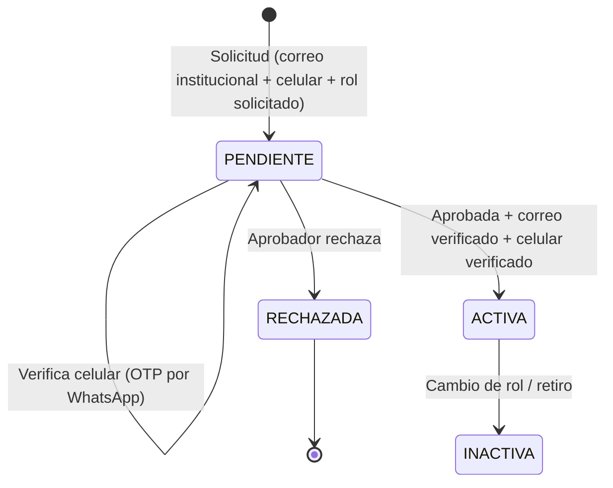

# 1. Visión, alcance y drivers arquitectónicos

## 1.1 Contexto

UCO Kudos es la plataforma institucional de reconocimientos de la Universidad Católica de Oriente. Permite que cualquier miembro de la comunidad (estudiantes, docentes, coordinadores, directivos) reconozca públicamente a otro en una categoría de valor institucional (Liderazgo, Empatía, Espíritu UCO…), adjunte evidencias y que el reconocido se entere de inmediato por correo, WhatsApp y notificación en tiempo real.

## 1.2 Arquitectura objetivo vs. línea base

El proyecto se desarrolló en **4 días**. Por eso se separa explícitamente:

- **Arquitectura objetivo**: la solución completa que la UCO necesita (todos los requisitos del enunciado). Está **diseñada** en este documento (modelo de datos, componentes, ADR, evolución).
- **Línea base ejecutable**: el subconjunto **construido, probado, automatizado y desplegado** que materializa la arquitectura y demuestra el flujo obligatorio *Publicar Kudo* de punta a punta.

| Capacidad | Línea base (implementado) | Arquitectura objetivo (diseñado) |
|---|---|---|
| Roles institucionales (7) y exclusividad de rol | ✅ Un único rol por usuario (`users.role`) | Historial de roles y vigencias |
| Reglas por rol: administrar categorías, vetar, ver auditoría | ✅ En el dominio (`Role`) y en la seguridad | — |
| Unicidad (un Rector activo, un Decano por facultad…) | Modelado | Índices únicos parciales en PostgreSQL + validación en caso de uso |
| Registro con aprobación + verificación de correo y celular | Diseñado (sección 1.5) | OTP por correo y WhatsApp + flujo de aprobaciones jerárquico |
| Estructura académica (facultades, programas, relaciones) | ✅ Tablas `faculties`, `programs`, `user_programs` | Administración completa por coordinadores |
| Categorías (15 mínimas) y su administración restringida | ✅ | — |
| **Publicar Kudo** (autor, destinatario, categoría, fecha, contenido sin límite, adjuntos) | ✅ | — |
| **Correo, WhatsApp y Push en tiempo real** | ✅ | Push nativo (Web Push / FCM) para usuarios desconectados |
| **Auditoría de todo el proceso** | ✅ BD + logs con traceId | Exportación a SIEM |
| Réplicas anidadas sin límite | Diseñado (modelo de datos) | Implementación |
| Calificaciones 1–5 (una activa por usuario y contenido) | Diseñado (modelo de datos) | Implementación |
| Reportes y vetos | Diseñado; regla `canVetoContent()` ya implementada | Implementación |
| Observabilidad (health, métricas, trazas, auditoría) | ✅ Actuator + Prometheus + traceId | Grafana / OpenTelemetry Collector |
| DevSecOps (CI, CD, Sonar, Trivy) | ✅ GitHub Actions | Entornos staging/prod, DAST |

## 1.3 Drivers arquitectónicos

| ID | Driver | Cómo responde la solución | Dónde verlo |
|---|---|---|---|
| DRV-001 | **Movilidad (90 % móvil)** | Front-End *Mobile First*: CSS diseñado para 360 px y ampliado con `min-width`; navegación inferior al alcance del pulgar; botones ≥ 48 px; inputs de 16 px (evita zoom en iOS); payload del muro paginado (10 ítems) y adjuntos solo con metadatos. Las pruebas E2E corren con viewport de Pixel 7. | `uco-kudos-web/src/styles.css`, `BottomNav.tsx`, `playwright.config.ts` |
| DRV-002 | **Alta demanda de lectura** | Caché Caffeine del muro y categorías (TTL 30 s, invalidación al publicar); índices `published_at DESC` y `recipient_id`; `JOIN FETCH` para evitar N+1; proyección sin binarios para adjuntos; paginación con tope de 50; `open-in-view=false`. Evolución: réplicas de lectura y caché distribuida (ADR-004). | `KudoRepositoryAdapter`, `KudoJPARepository`, `V1__esquema_inicial.sql` |
| DRV-003 | **Notificaciones multicanal** | Puerto `NotificationSender` (Strategy) con tres adaptadores: Brevo/SMTP, Twilio WhatsApp y SSE. Se ejecutan asíncronamente tras el commit, con reintentos, métricas y auditoría por canal. | `services/output/ports/notifications`, `infrastructure/output/notifications` |
| DRV-004 | **Adjuntos** | `multipart/form-data`, máx. 5 archivos × 5 MB, lista blanca PNG/JPEG/WEBP/PDF validada por *magic bytes*, nombre saneado, checksum SHA-256. | `AttachmentDomain`, `FileTypeDetector` |
| DRV-005 | **Seguridad** | JWT HS256 de vida corta, BCrypt, autorización por rol en dos capas, CORS restringido, secretos por entorno, Problem Details sin stack traces, imagen sin root. Ver documento 07. | `SecurityConfig`, `docs/07` |
| DRV-006 | **Observabilidad** | `/actuator/health`, `/actuator/prometheus` (métricas propias `kudos.notifications`, `kudos.push.connections`), traceId por petición en logs, cabecera y auditoría; logs JSON (ECS) en producción. | `TraceIdFilter`, `ResilientNotificationSender`, `AuditRepositoryAdapter` |
| DRV-007 | **Automatización** | Pipelines CI/CD en ambos repositorios con pruebas, cobertura, Sonar, Trivy (repo e imagen), publicación de imagen, despliegue y pruebas E2E post-despliegue. | `.github/workflows/ci-cd.yml` |

## 1.4 Atributos de calidad (escenarios)

| Atributo | Estímulo | Respuesta esperada | Medida | Táctica |
|---|---|---|---|---|
| Desempeño (lectura) | 100 usuarios abren el muro a la vez | Se responde desde caché | p95 < 300 ms en caché caliente | Caché, índices, paginación |
| Responsividad (escritura) | Un usuario publica un Kudo | Recibe 201 sin esperar a SMTP/Twilio | La respuesta no incluye el tiempo de los proveedores | Evento + procesamiento asíncrono |
| Disponibilidad / resiliencia | Twilio no responde | El Kudo se guarda; correo y push se envían igual; el fallo queda auditado | 0 Kudos perdidos | Aislamiento por canal, reintentos, timeouts, bulkhead |
| Seguridad | Se sube `virus.exe` renombrado a `foto.png` | Se rechaza con 422 | 100 % de archivos fuera de lista blanca rechazados | Validación por firma |
| Seguridad | Un estudiante intenta crear una categoría | 403 | — | RBAC en filtro + regla de dominio |
| Auditabilidad | Cualquier publicación | Queda registro de la publicación y de cada canal | 4 registros por Kudo | Auditoría append-only |
| Mantenibilidad | Agregar canal SMS | Nueva clase que implementa `NotificationSender` | 0 cambios en casos de uso | Puertos y adaptadores, OCP |
| Desplegabilidad | Merge a `main` | Pruebas, análisis, imagen y despliegue automáticos | < 15 min sin intervención | CI/CD |

## 1.5 Diseño del registro y activación (arquitectura objetivo)

Matriz de aprobación (regla de dominio planeada como `Role.approverOf()`):

| Solicitud | Aprobador |
|---|---|
| Estudiante (y Docente) | Coordinador de Programa |
| Coordinador de Programa | Coordinador de Facultad |
| Coordinador de Facultad | Coordinador Académico |
| Coordinador Académico | Rector |
| Rector | Administrador |
| Administrador | Administrador |

En la línea base las cuentas se crean ya activas mediante un *seeder* (un usuario por rol) para poder demostrar el flujo obligatorio.
