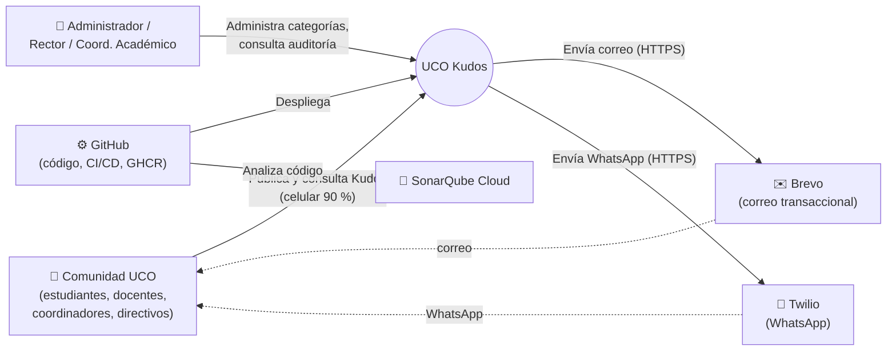
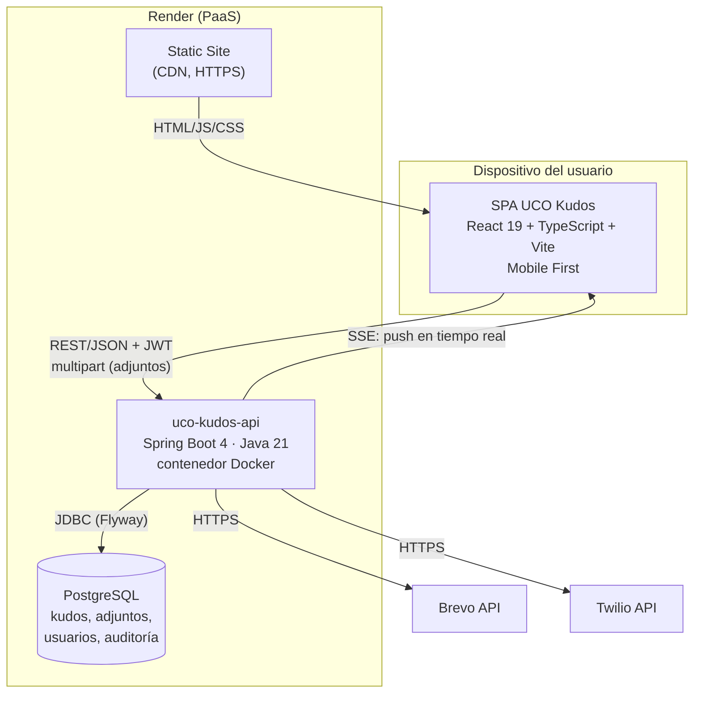
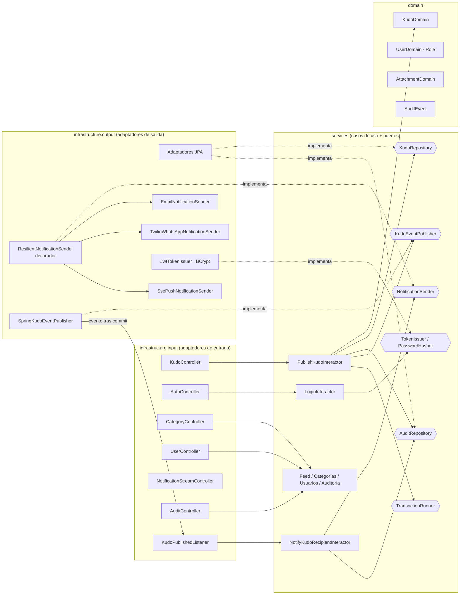
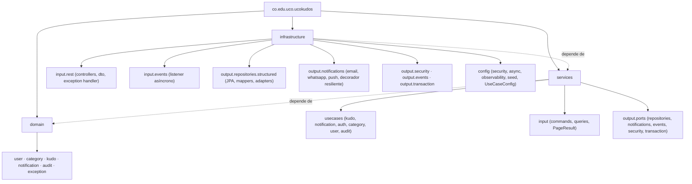
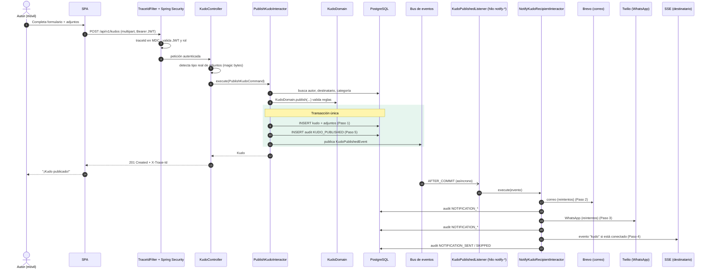
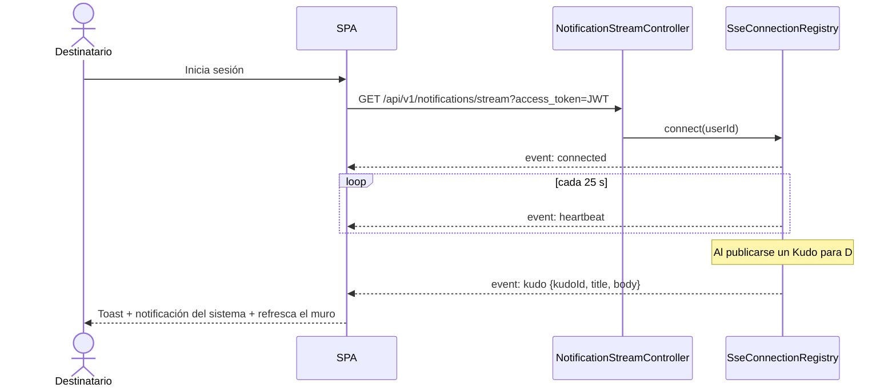
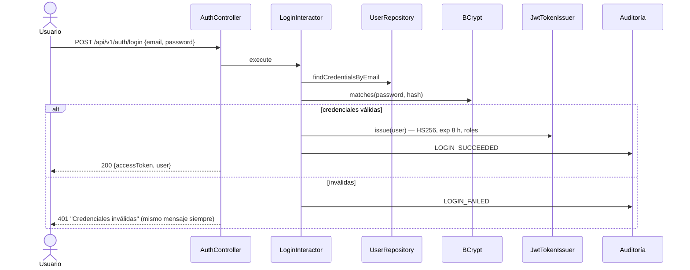
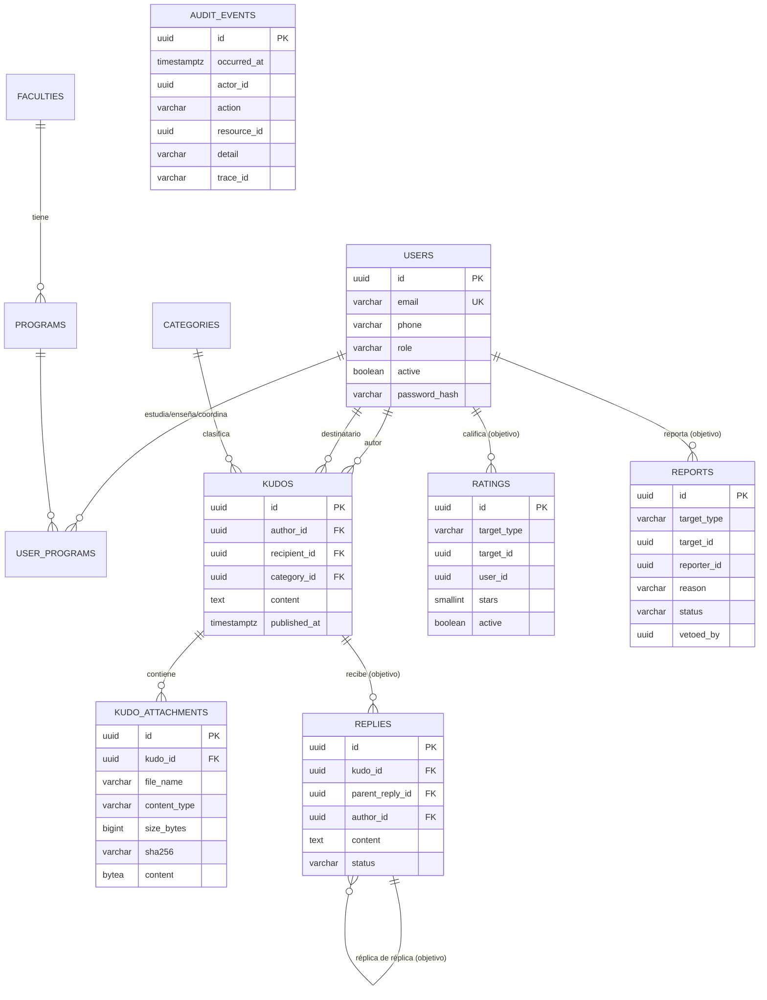

# 2. Diseño arquitectónico (alto nivel y detallado)

Notación: modelo **C4** (nivel 1 contexto, nivel 2 contenedores, nivel 3 componentes) en Mermaid.

## 2.1 Diagrama de nivel 1 — Contexto

## 2.2 Diagrama de nivel 2 — Contenedores

| Contenedor | Tecnología | Responsabilidad |
|---|---|---|
| SPA | React + Vite (estático) | Interfaz móvil, sesión, conexión SSE |
| API | Spring Boot (monolito modular hexagonal) | Reglas de negocio, seguridad, notificaciones, auditoría, métricas |
| Base de datos | PostgreSQL 17 | Persistencia transaccional (incluye binarios de adjuntos en la línea base, ver ADR-006) |

## 2.3 Diagrama de componentes (nivel 3 — API)

Las flechas de dependencia siempre apuntan **hacia el dominio**. Los adaptadores de salida implementan interfaces (puertos) definidas en `services`.

## 2.4 Diagrama de paquetes

Reglas (verificadas automáticamente por `CleanArchitectureRulesTest`):

1. `domain` no importa nada de `services`, `infrastructure`, Spring ni JPA.
2. `services` no importa Spring, JPA ni `infrastructure`.
3. Solo `infrastructure.config.UseCaseConfig` (Composition Root) conoce casos de uso e implementaciones a la vez.

## 2.5 Diagramas de secuencia principales

### 2.5.1 Publicar Kudo (flujo obligatorio de la línea base)

### 2.5.2 Conexión en tiempo real (push)

### 2.5.3 Inicio de sesión

## 2.6 Modelo de datos

Notas de la arquitectura objetivo:

- **Réplicas sin límite de profundidad**: lista de adyacencia (`parent_reply_id`) + `kudo_id` desnormalizado para leer todo el hilo de un Kudo en una sola consulta; la UI construye el árbol.
- **Una calificación activa por usuario y contenido**: índice único parcial `UNIQUE (user_id, target_type, target_id) WHERE active`.
- **Unicidad de roles**: índice único parcial `UNIQUE (role) WHERE active AND role IN ('RECTOR','COORDINADOR_ACADEMICO')`; para Decano y Coordinador de Programa, unicidad sobre `user_programs` con `relation='COORDINA'`.
- **Veto**: solo `Role.canVetoContent()` (Rector y Coordinador Académico); el contenido vetado se oculta (borrado lógico) y se audita.
