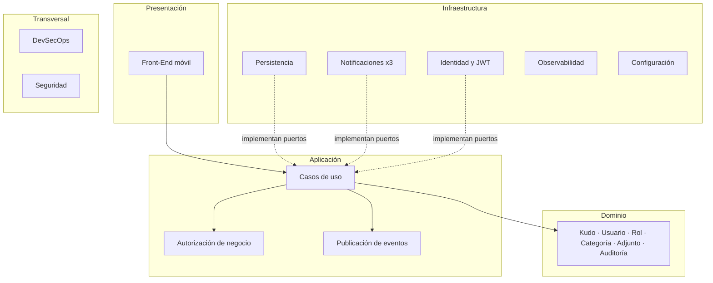

# 3. Architecture Building Blocks (ABB) y Solution Building Blocks (SBB)

Un **ABB** describe *qué capacidad* necesita la arquitectura, independiente de la tecnología. Un **SBB** es *el producto o componente concreto* que la materializa. La selección priorizó: costo cero (plan gratuito), baja complejidad para 4 días, y que cada SBB quede **detrás de un puerto** para poder reemplazarlo sin tocar el negocio.

## 3.1 Matriz ABB → SBB

| ABB | Justificación (driver) | SBB línea base | Alternativas evaluadas | Costo | Complejidad | Escalabilidad | Riesgos | Evolución futura |
|---|---|---|---|---|---|---|---|---|
| **Gestión de identidad** | Usuarios, rol único, contacto | Tabla `users` + `UserRepository` (PostgreSQL) | Keycloak, Auth0 | $0 | Baja | Media | Sin MFA ni federación | Keycloak / Entra ID con SSO institucional |
| **Autenticación** | DRV-005 | JWT HS256 firmado por la API (Spring Security OAuth2 Resource Server) + BCrypt | Sesiones con cookie, Keycloak | $0 | Baja | Alta (stateless) | Clave simétrica compartida; sin revocación | RS256 emitido por IdP, refresh tokens, revocación |
| **Autorización** | Reglas por rol del enunciado | RBAC en dos capas: `SecurityFilterChain` (rutas) + `Role` (dominio) | ABAC, OPA | $0 | Baja | Alta | Reglas en código | Políticas externas si crecen las reglas |
| **Persistencia** | Kudos, auditoría, estructura académica | PostgreSQL 17 + Spring Data JPA/Hibernate + Flyway | MongoDB, MySQL | $0 (Render free) | Baja | Vertical + réplicas de lectura | Plan gratuito expira a 30 días | Postgres gestionado con réplicas (DRV-002) |
| **Gestión documental / archivos** | DRV-004 | Tabla `kudo_attachments` (`bytea`) + validación por firma + SHA-256 | S3, Cloudflare R2, Cloudinary | $0 | Muy baja | Limitada (crece la BD) | Tamaño de la BD | Object storage (R2/S3) + URLs prefirmadas (ADR-006) |
| **Notificaciones — correo** | DRV-003 | Brevo API HTTP (300/día gratis); SMTP como alternativa | SendGrid, Resend, Gmail SMTP | $0 | Baja | Alta | Render free bloquea SMTP → se eligió HTTP | Plantillas transaccionales, dominio propio con SPF/DKIM |
| **Notificaciones — WhatsApp** | DRV-003 | Twilio WhatsApp Sandbox vía REST | Meta Cloud API, Infobip | $0 (sandbox) | Media | Alta | Sandbox exige `join` y ventana de 24 h | Número aprobado + plantillas Meta |
| **Notificaciones — push** | DRV-003 paso 4 | Server-Sent Events (Spring MVC `SseEmitter`) | WebSocket/STOMP, FCM, Web Push | $0 | Baja | Una instancia | Registro en memoria | Redis Pub/Sub entre instancias + Web Push (ADR-005) |
| **Mensajería / eventos** | Desacoplar escritura de notificación | Eventos de Spring + `@TransactionalEventListener` + `@Async` (pool dedicado) | RabbitMQ, Kafka, SQS | $0 | Baja | Una instancia | Evento en memoria se pierde si la app cae justo después del commit | Outbox transaccional + broker (ADR-003) |
| **Auditoría** | Paso 5 del flujo | Tabla `audit_events` append-only + logger `AUDIT` | Envers, Debezium | $0 | Baja | Media | Crece sin límite | Particionado por fecha, exportación a SIEM |
| **Logging** | DRV-006 | SLF4J/Logback, traceId en MDC, formato ECS JSON en prod | Log4j2 | $0 | Baja | — | Logs efímeros en Render free | Envío a Loki/Elastic |
| **Observabilidad** | DRV-006 | Spring Boot Actuator + Micrometer + Prometheus endpoint | OpenTelemetry + Grafana | $0 | Baja | — | Sin almacenamiento de series | Grafana Cloud scrapeando `/actuator/prometheus`, OTel tracing |
| **Gestión de configuración** | Twelve-Factor III | Variables de entorno → `@ConfigurationProperties` validados | Spring Cloud Config, Vault | $0 | Baja | — | Secretos en el panel de Render | Vault / Secret Manager |
| **Seguridad perimetral** | DRV-005 | HTTPS de Render, CORS restringido, cabeceras de seguridad de Spring | WAF, API Gateway | $0 | Baja | — | Sin rate limiting | API Gateway con rate limit |
| **DevSecOps** | DRV-007 | GitHub Actions + SonarQube Cloud + Trivy 0.69.3 + GHCR + Render deploy hooks | GitLab CI, Jenkins, Snyk | $0 | Media | — | Dependencia de servicios SaaS | Entornos staging/prod, DAST (OWASP ZAP), firma de imágenes |
| **Front-End** | DRV-001 | React 19 + TypeScript + Vite (SPA estática) | Angular, Flutter, PWA | $0 | Baja | CDN | — | PWA instalable + Web Push |
| **Cómputo / hosting** | Publicación obligatoria | Render: Web Service Docker + Static Site + PostgreSQL | Railway, Fly.io, Azure | $0 | Baja | Horizontal (planes pagos) | Free se duerme tras 15 min (arranque en frío ~1 min) | Plan pagado o Kubernetes |

## 3.2 Mapa de capacidades por capa

