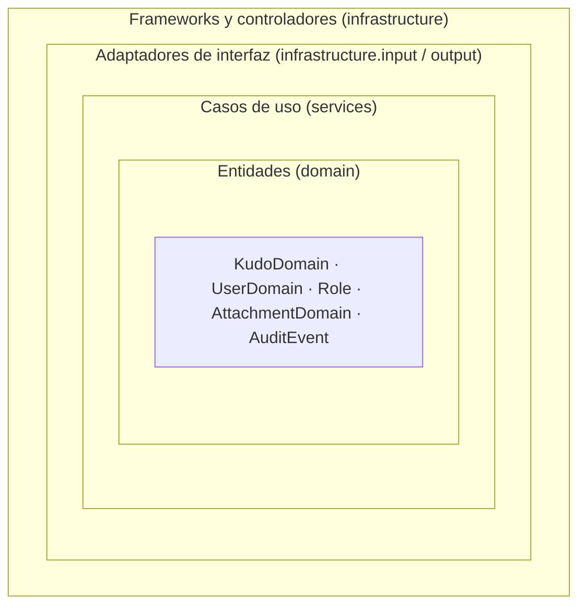

# 5. Clean Architecture, SOLID, Clean Code y patrones de diseño

## 5.1 Capas, responsabilidades y dependencias

| Capa | Paquete | Responsabilidad | Puede depender de |
|---|---|---|---|
| Entidades | `domain` | Reglas de negocio puras: un Kudo no puede ser para uno mismo, máx. 5 adjuntos, tipos permitidos, quién administra categorías o veta, formato de celular E.164 | Solo JDK |
| Casos de uso | `services.usecases` | Orquestan un flujo: buscar, validar, persistir, auditar, publicar evento | `domain` y sus propios puertos |
| Puertos | `services.output.ports` | Interfaces que el caso de uso necesita del exterior (`KudoRepository`, `NotificationSender`, `TokenIssuer`…) | `domain` |
| Adaptadores de entrada | `infrastructure.input` | Traducen HTTP/eventos a comandos (`KudoController`, `KudoPublishedListener`) | `services` |
| Adaptadores de salida | `infrastructure.output` | Implementan los puertos con tecnología (JPA, Brevo, Twilio, SSE, JWT) | `services`, `domain`, frameworks |
| Configuración | `infrastructure.config` | Composition Root, seguridad, async, observabilidad | Todo |

**Reglas arquitectónicas**

1. **Regla de dependencia**: el código fuente solo apunta hacia adentro. Verificado por `CleanArchitectureRulesTest` en cada build; además el núcleo compila con `javac` sin ninguna librería.
2. El dominio se valida a sí mismo en su construcción (los `record` lanzan `DomainException`): no existe un `KudoDomain` inválido.
3. Las entidades JPA (`*EntityJPA`) nunca salen del adaptador; se mapean a objetos de dominio.
4. Los DTO REST (`*Request/*Response`) nunca entran a los casos de uso; se traducen a comandos.
5. Los adaptadores de notificación no lanzan excepciones: devuelven `NotificationResult` para que todo quede auditado.

## 5.2 SOLID aplicado

| Principio | Evidencia en el código |
|---|---|
| **S** — Responsabilidad única | `PublishKudoInteractor` publica; `NotifyKudoRecipientInteractor` notifica; `ResilientNotificationSender` solo agrega resiliencia y métricas; `FileTypeDetector` solo detecta tipos. |
| **O** — Abierto/cerrado | Un canal nuevo (SMS, Teams) = una nueva clase `NotificationSender`; Spring la inyecta en la lista y ningún caso de uso cambia. |
| **L** — Sustitución de Liskov | Cualquier `NotificationSender` (real, decorado o de prueba) es intercambiable; las pruebas usan implementaciones en memoria. |
| **I** — Segregación de interfaces | Puertos pequeños y específicos: `TokenIssuer`, `PasswordHasher`, `TransactionRunner`, `KudoEventPublisher` en lugar de un "servicio de infraestructura" gigante. |
| **D** — Inversión de dependencias | Los casos de uso dependen de interfaces definidas por ellos mismos; las implementaciones viven en `infrastructure` y se inyectan en `UseCaseConfig`. |

## 5.3 Clean Code

- **Nombres expresivos** en el lenguaje del negocio: `KudoDomain.publish`, `canManageCategories`, `findAttachmentMetadata`, pruebas como `noSePuedeDarUnKudoAUnoMismo`.
- **Métodos cortos y cohesivos**: `PublishKudoInteractor.execute` se lee como el flujo del enunciado; los detalles (`toAttachments`, `toNotification`, `sha256`) están en métodos privados.
- **Inmutabilidad**: dominio y DTO como `record`; listas defensivas con `List.copyOf`.
- **Sin números mágicos**: `MAX_ATTACHMENTS`, `MAX_SIZE_BYTES`, `PREVIEW_LENGTH`, `TIMEOUT_MILLIS`.
- **Errores explícitos**: excepciones de dominio con significado (`DomainException` → 422, `ResourceNotFoundException` → 404, `AccessDeniedDomainException` → 403, `InvalidCredentialsException` → 401).
- **Bajo acoplamiento / alta cohesión**: cada paquete agrupa lo que cambia junto (p. ej. todo lo de WhatsApp está en `notifications/whatsapp`).
- **Calidad medida**: SonarQube Cloud con *quality gate* bloqueante en el pipeline.

## 5.4 Patrones de diseño utilizados

| Patrón | Dónde | Problema que resuelve | Beneficio obtenido |
|---|---|---|---|
| **Ports & Adapters (Hexagonal)** | `services.output.ports` ↔ `infrastructure.output` | Aislar el negocio de BD y proveedores | Cambiar Twilio por Meta o Postgres por otra BD sin tocar casos de uso |
| **Strategy** | `NotificationSender` (Email, WhatsApp, Push) | Varios canales con la misma intención | El interactor recorre la lista sin `if/switch` por canal |
| **Decorator** | `ResilientNotificationSender` | Agregar reintentos, métricas y contención a cualquier canal | Comportamiento transversal sin duplicar código en cada adaptador |
| **Adapter** | `TwilioWhatsAppNotificationSender`, `*RepositoryAdapter` | Contratos externos distintos al nuestro | Traducción en un único lugar |
| **Observer / Event-driven** | `KudoPublishedEvent` + `@TransactionalEventListener` | Desacoplar la escritura de las notificaciones | Respuesta rápida y notificación solo tras commit |
| **Repository** | `KudoRepository`, `UserRepository`… | Acceso a datos con lenguaje de dominio | Pruebas con mocks; consultas optimizadas encapsuladas |
| **Factory Method** | `KudoDomain.publish`, `CategoryDomain.create`, `AuditEvent.ofNotification` | Crear objetos válidos | Imposible construir un Kudo que viole reglas |
| **Command** | `PublishKudoCommand`, `LoginCommand`… | Entrada explícita de cada caso de uso | Contratos claros, sin acoplarse a HTTP |
| **Data Mapper** | `KudoEntityMapper`, `UserEntityMapper` | Separar modelo de persistencia y de dominio | El dominio no conoce anotaciones JPA |
| **Template Method / Decorator transaccional** | `TransactionRunner` | Transacciones sin Spring en el núcleo | Casos de uso puros |
| **Bulkhead** | Pool `notificationExecutor` | Proveedores lentos agotando hilos HTTP | Fallos contenidos en un pool acotado |
| **Retry con backoff** | `ResilientNotificationSender` | Fallos transitorios de red | Mayor tasa de entrega |
| **Object Mother** (pruebas) | `TestData` | Datos de prueba repetitivos | Pruebas legibles |
