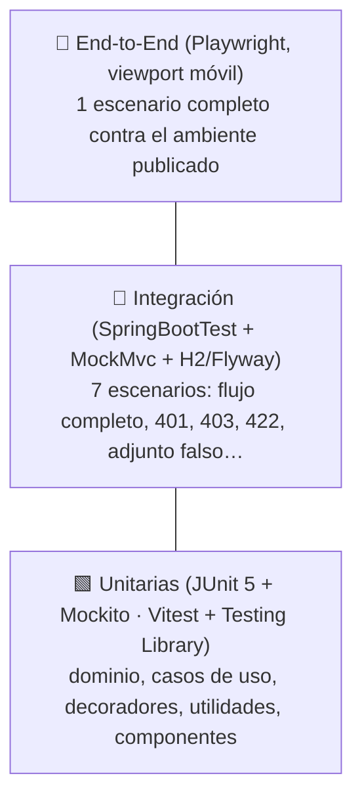
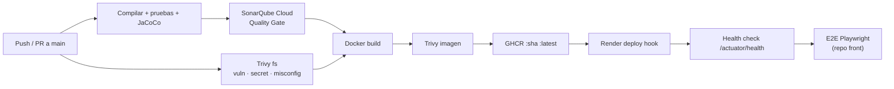

# 8. Pirámide de pruebas, observabilidad y DevSecOps

## 8.1 Pirámide de pruebas

| Nivel | Back-End | Front-End | Qué demuestra |
|---|---|---|---|
| **Unitarias** | `KudoDomainTest`, `AttachmentDomainTest`, `RoleTest`, `PublishKudoInteractorTest`, `NotifyKudoRecipientInteractorTest`, `LoginInteractorTest`, `ResilientNotificationSenderTest`, `SsePushNotificationSenderTest`, `FileTypeDetectorTest`, `CleanArchitectureRulesTest` | `format.test.ts`, `client.test.ts`, `KudoCard.test.tsx`, `LoginView.test.tsx`, `PublishKudoView.test.tsx` | Reglas de negocio, aislamiento de fallos, reintentos, seguridad de archivos, regla de dependencia |
| **Integración** | `PublishKudoFlowIntegrationTest`: API real + seguridad + JPA + Flyway + evento asíncrono + auditoría | — | Que las piezas funcionan juntas: 201 + persistencia + 4 registros de auditoría |
| **End-to-End** | — | `e2e/publicar-kudo.spec.ts` | Un docente inicia sesión en un celular, publica un Kudo y lo ve en el muro, sobre la URL pública |

Comandos: `./mvnw verify` (back, incluye JaCoCo), `npm test` (front, con cobertura), `npm run test:e2e` (con `E2E_BASE_URL`).

## 8.2 Observabilidad

| Señal | Implementación | Cómo evidenciarla |
|---|---|---|
| **Salud** | `/actuator/health` (+ `liveness`/`readiness`) | Abrir `https://<api>/actuator/health` → `{"status":"UP"}` |
| **Métricas** | Micrometer → `/actuator/prometheus`: `http_server_requests_seconds`, JVM, HikariCP, caché, y **propias**: `kudos_notifications_total{channel,status}`, `kudos_notifications_duration_seconds`, `kudos_push_connections` | Publicar un Kudo y buscar `kudos_notifications_total` |
| **Trazas / correlación** | `TraceIdFilter`: traceId por petición (o `X-Request-Id`), en MDC, cabecera `X-Trace-Id`, propagado al hilo asíncrono por `TaskDecorator`, guardado en `audit_events.trace_id` | El mismo traceId aparece en la respuesta, en los logs de la petición, de las notificaciones y en la auditoría |
| **Logs** | stdout; JSON ECS con `LOGGING_STRUCTURED_FORMAT_CONSOLE=ecs` | Panel *Logs* de Render |
| **Auditoría** | `audit_events` + logger `AUDIT`; endpoint `GET /api/v1/audit?resourceId=<kudoId>` (Admin/Rector/Coord. Académico) | Ver los 4 eventos de un Kudo |

## 8.3 DevSecOps

| Práctica | Back-End | Front-End |
|---|---|---|
| CI | `mvnw verify` (unitarias + integración + cobertura) | `typecheck` + `vitest --coverage` + `vite build` |
| Análisis estático | SonarQube Cloud (Maven plugin), quality gate bloqueante | SonarQube Cloud (`@sonar/scan`), cobertura lcov |
| Vulnerabilidades | Trivy fs (dependencias, secretos, Dockerfile) + Trivy imagen; falla con CRÍTICAS que tengan parche | Trivy fs sobre `package-lock.json` |
| Artefacto | Imagen Docker multi-etapa, JRE Alpine, usuario sin root → GHCR | `dist/` estático |
| CD | Deploy hook de Render + verificación de salud | Deploy hook de Render + verificación + E2E post-despliegue |
| Reportes | Artefactos: surefire, JaCoCo, trivy-fs, trivy-image | Artefactos: cobertura, trivy, reporte Playwright |

Política de excepciones de Trivy: `.trivyignore` con CVE, justificación y fecha de revisión.
