# 10. Evidencias

Todas las capturas están en la carpeta `docs/evidencias/`. Fueron tomadas el 13 de noviembre de 2026 sobre el ambiente publicado:

- Front-End: https://uco-kudos-web.onrender.com
- Back-End: https://uco-kudos-api.onrender.com

## Resumen

| Evidencia exigida | Archivo |
|---|---|
| CI | `01-ci-backend.jpg`, `02-ci-frontend.jpg` |
| CD | `03-cd-backend.jpg` |
| Sonar | `04-sonar-backend.jpg`, `05-sonar-frontend.jpg` |
| Trivy | `06-trivy-bloqueo.jpg`, `07-trivy-ok.jpg` |
| Pruebas | `08-pruebas-backend-cobertura.jpg`, `09-pruebas-frontend.jpg`, `16-pruebas-e2e.jpg` |
| Despliegue | `10-render-despliegue.jpg` |
| Observabilidad | `11-observabilidad-health.jpg`, `17-observabilidad-metricas.jpg` |
| Publicación | `12-publicacion-escritorio.jpg`, `13-publicacion-movil.jpg` |
| Correo electrónico | `14-correo.jpg` |
| WhatsApp | `15-whatsapp.jpg` |
| Push Notifications | `18-push-escritorio.jpg`, `18-push-movil.jpg` |
| Auditoría | `19-auditoria.jpg` |

## CI

Pipeline del Back-End: compilación, pruebas, análisis con Sonar, Trivy del repositorio, construcción de la imagen, Trivy de la imagen y despliegue, todo en verde.

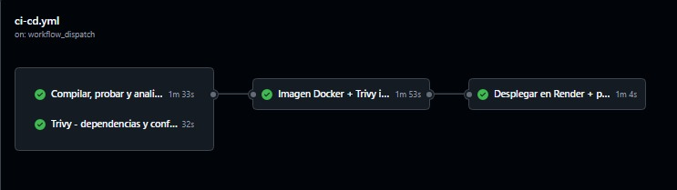

Pipeline del Front-End: tipos, pruebas, build, Sonar, Trivy, despliegue y pruebas End-to-End sobre el ambiente publicado.

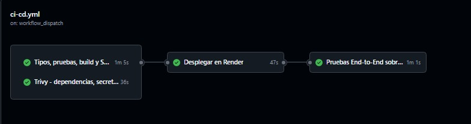

## CD

El job de despliegue invoca el deploy hook de Render (oculto como secreto) y espera a que `/actuator/health` responda HTTP 200 antes de dar el despliegue por exitoso.

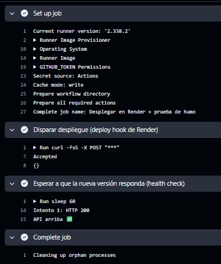

## Sonar

Quality Gate aprobado en ambos proyectos.

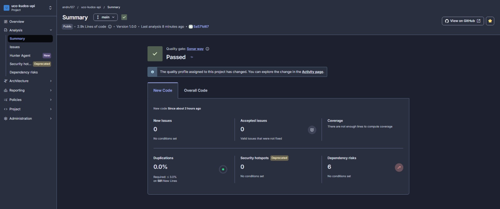

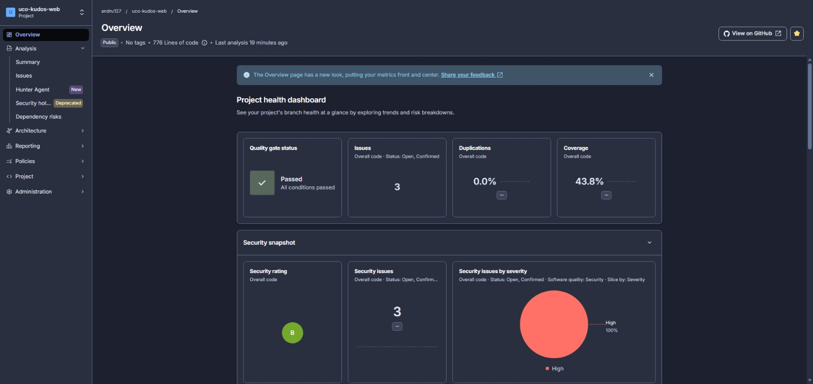

## Trivy

El escaneo de la imagen detectó 4 vulnerabilidades CRITICAL en Tomcat embebido (versión 11.0.24) y bloqueó el despliegue. Se actualizó Tomcat a 11.0.25 y Jackson a 3.1.7 en el `pom.xml` (commit "Actualiza Tomcat y Jackson por vulnerabilidades reportadas por Trivy") y el pipeline volvió a pasar. Esto evidencia el ciclo DevSecOps: detectar, bloquear, corregir y desplegar.

Ejecución bloqueada por Trivy:

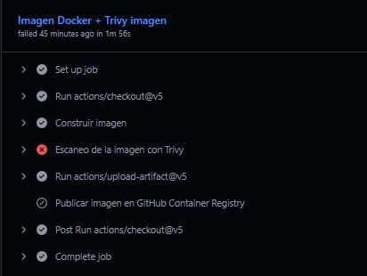

Ejecución corregida:

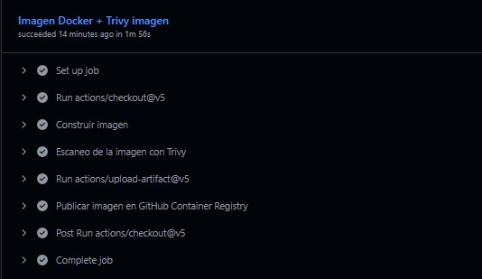

## Pruebas

Back-End: 85 pruebas (unitarias e integración), cobertura de instrucciones del 95 % medida con JaCoCo.

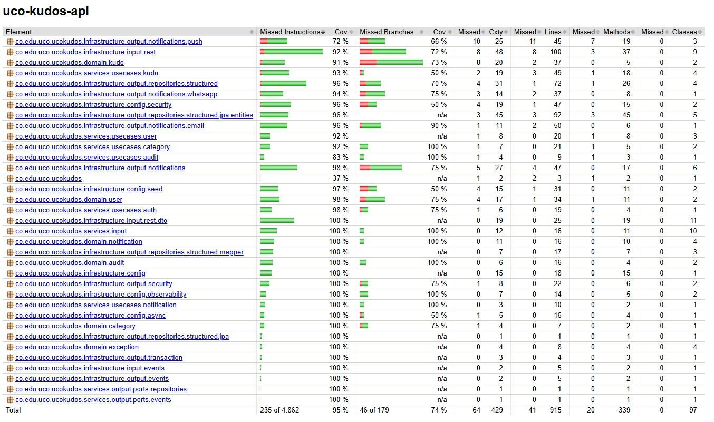

Front-End: 18 pruebas unitarias y de componentes con Vitest.

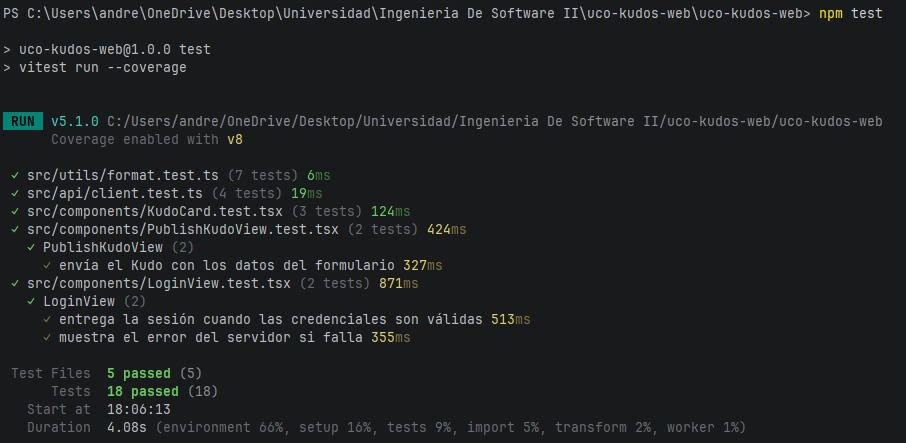

End-to-End: Playwright con viewport móvil, ejecutado por el pipeline contra la URL publicada.

## Despliegue

Servicios publicados en Render: la API como contenedor Docker y el Front-End como sitio estático.

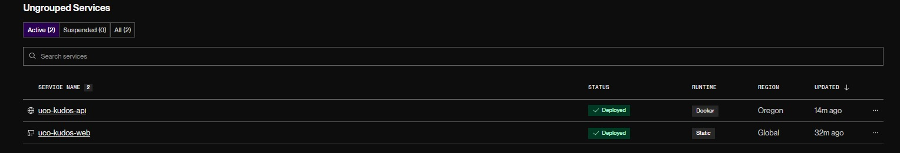

## Observabilidad

Endpoint de salud con los grupos liveness y readiness.

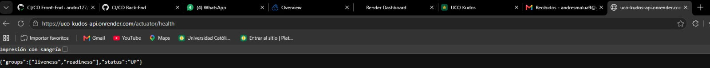

Métricas en formato Prometheus, incluidas las propias `kudos_notifications_total` y `kudos_push_connections`.

## Publicación

Aplicación publicada en escritorio y en celular.

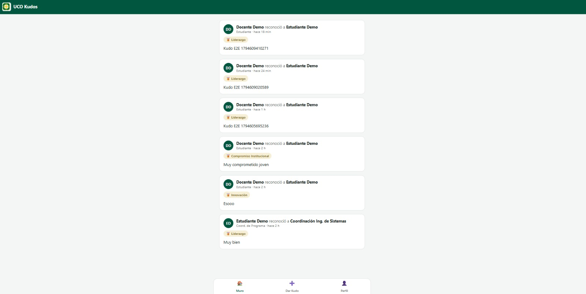

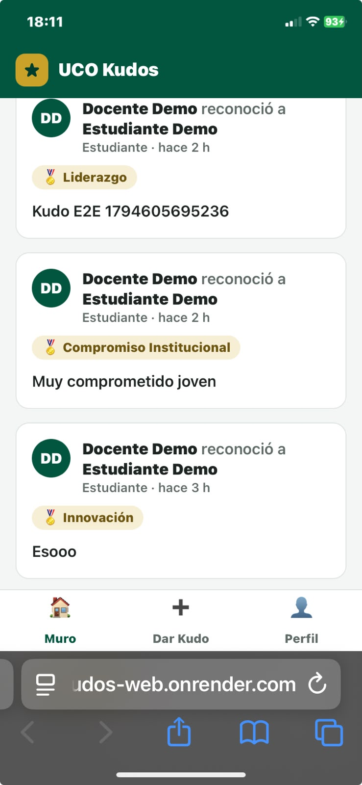

## Correo electrónico

Correo recibido por el destinatario del Kudo, enviado por Brevo, con autor, categoría y mensaje.

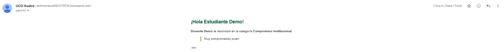

## WhatsApp

Mensajes recibidos desde el número de prueba de Twilio. La cuenta de prueba solo permite plantillas preaprobadas, por lo que el texto corresponde a la plantilla de ejemplo de Twilio; el adaptador ya soporta plantillas propias mediante `TWILIO_CONTENT_SID` y `TWILIO_CONTENT_VARIABLES`.

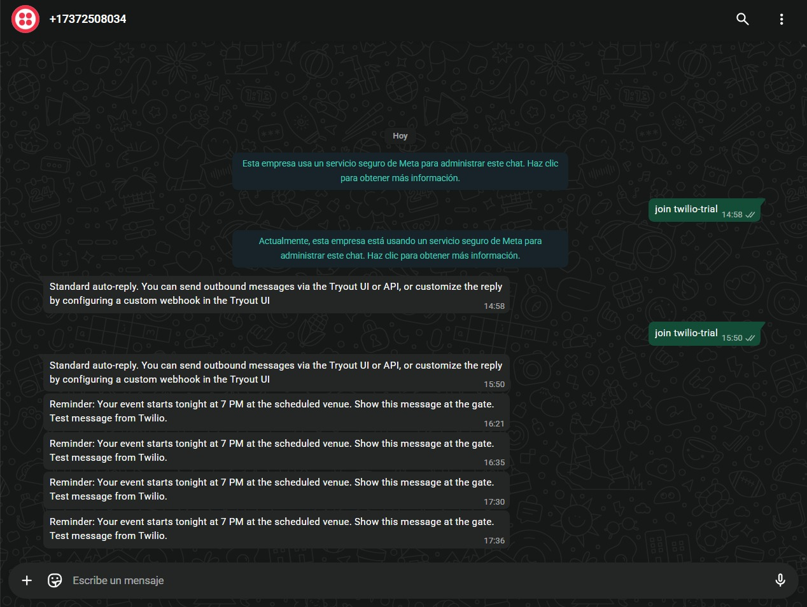

## Push Notifications

Aviso en tiempo real recibido por el destinatario con la aplicación abierta (Server-Sent Events). Al llegar el evento, la aplicación muestra el aviso y actualiza el muro sin recargar la página.

En escritorio, el Docente Demo recibe el Kudo que le envió el Estudiante Demo:

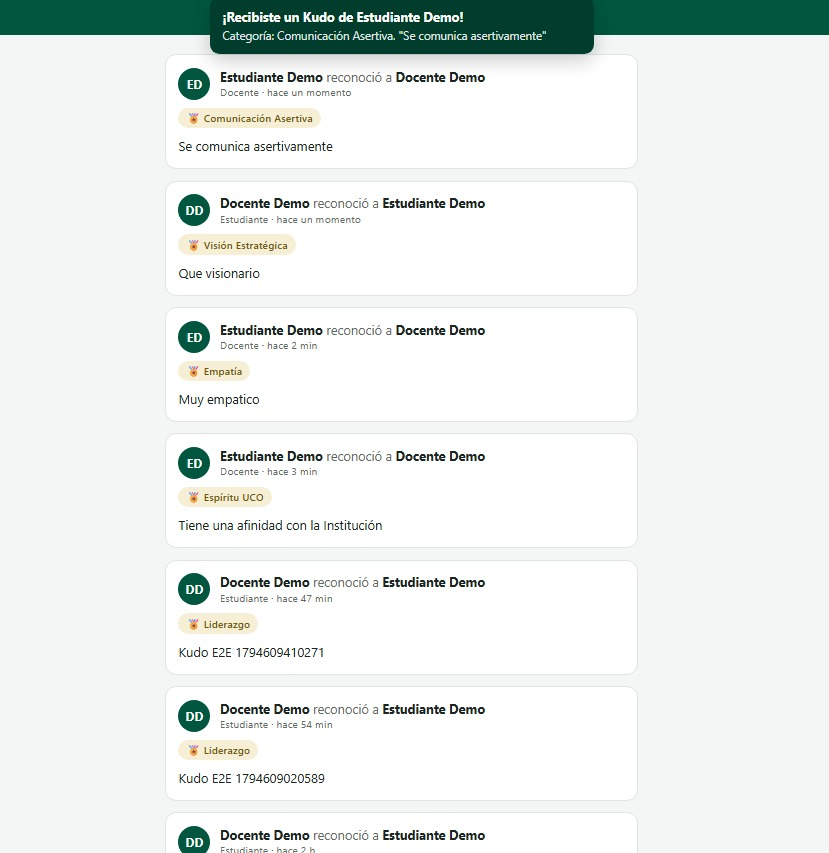

En celular, el Estudiante Demo recibe el Kudo que le envió el Docente Demo:

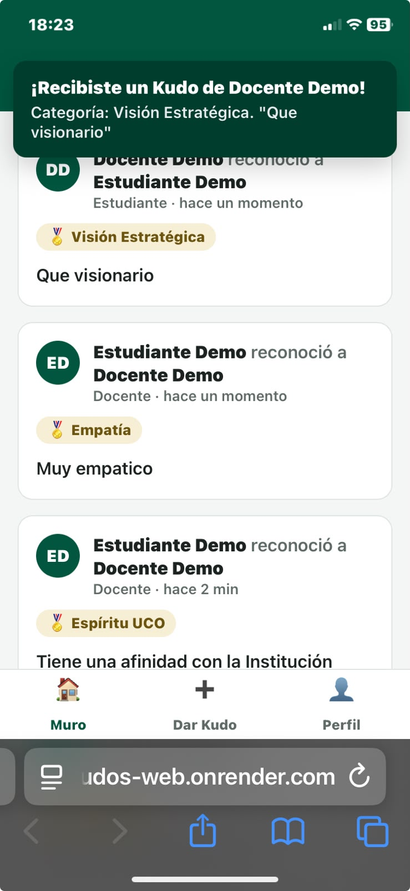

## Auditoría

Registros `KUDO_PUBLISHED` y `NOTIFICATION_SENT` (EMAIL, WHATSAPP y PUSH) de un mismo Kudo, con el mismo traceId.

Consulta equivalente en la base de datos:

```sql
SELECT occurred_at, action, detail, trace_id
FROM audit_events
WHERE resource_id = '<kudoId>'
ORDER BY occurred_at;
```
